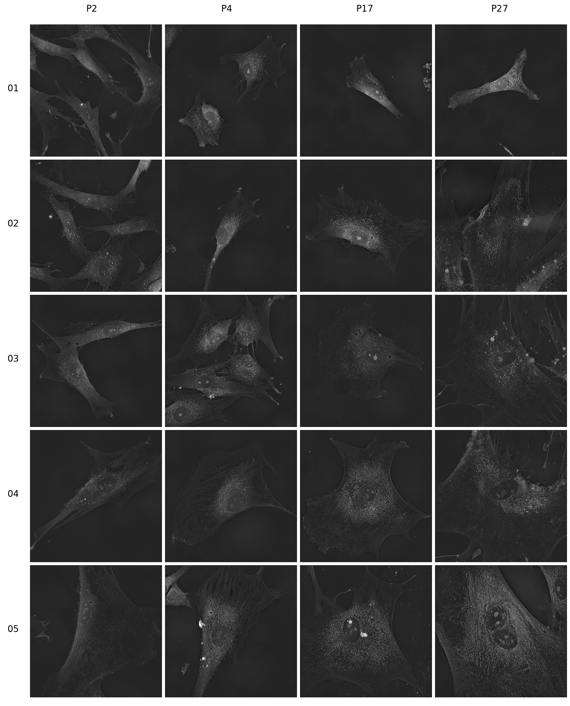

# Cellular senescence: AIF inference and example images

Public materials accompanying the cellular senescence study.

- [Inference and final-mask analysis code / instructions](GITHUB_PUBLIC_CODE_ONLY/README.md)
- [한국어 실행 안내](GITHUB_PUBLIC_CODE_ONLY/README_KO.md)
- [Twenty representative AIF images: downloads and PNG previews](data/README.md)

| Passage | Images | Download |
|---|---:|---|
| P2 | 5 | [AIF20_P2.zip](data/AIF20_P2.zip?raw=true) |
| P4 | 5 | [AIF20_P4.zip](data/AIF20_P4.zip?raw=true) |
| P17 | 5 | [AIF20_P17.zip](data/AIF20_P17.zip?raw=true) |
| P27 | 5 | [AIF20_P27.zip](data/AIF20_P27.zip?raw=true) |

Original NPY arrays are unchanged from the previous v1.1.0 example distribution.
PNG previews allow visual inspection. Public images contain physical RI values
and are not the 0–1 model-ready arrays required by the inference interface.
This repository alone cannot reproduce scores: model-ready inputs, model
artifacts and fixed score parameters must be supplied separately.

Nuclear masks, model weights, fixed score coefficients, actual study settings,
HT-to-AIF generation and model-training sources are not distributed here.

## License

[PolyForm Noncommercial License 1.0.0](LICENSE)
(SPDX: PolyForm-Noncommercial-1.0.0) applies only to
`GITHUB_PUBLIC_CODE_ONLY/score_aif.py`,
`GITHUB_PUBLIC_CODE_ONLY/inference.py` and
`GITHUB_PUBLIC_CODE_ONLY/common.py`.
It does not cover the final-mask analysis code, example AIF images or other
research data, model weights, fixed score coefficients, or third-party
dependencies. Third-party dependencies retain their respective licenses.
See the [detailed scope](GITHUB_PUBLIC_CODE_ONLY/README.md#license).
